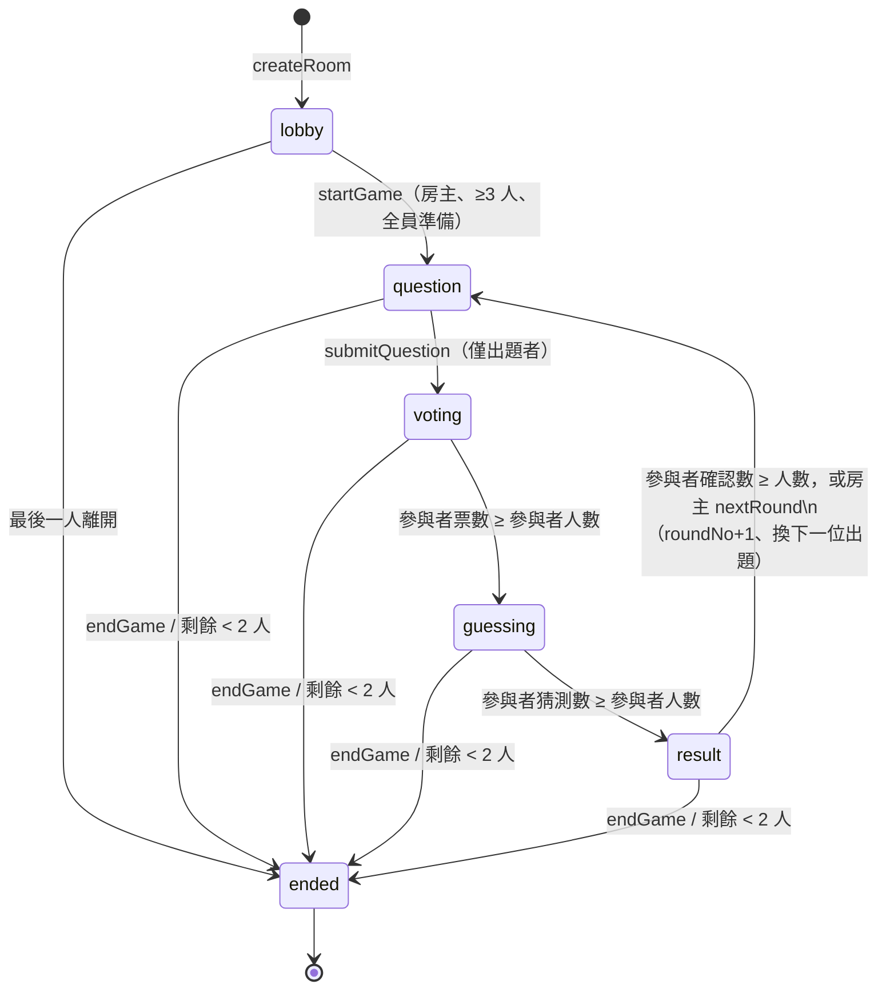

# 架構設計

## 1. 技術選擇一覽

| 層面 | 選擇 | 原因 |
| --- | --- | --- |
| 前端 | Taro 4 + React 18 + TypeScript (strict) | 題目指定；React 生態熟悉、Taro 直接產出原生小程序 |
| 後端 | 微信雲開發，**單一雲函數 `game`** 以 `action` 分派 | 14 個操作共用驗證與工具函數；一次部署、一份冷啟動，比 14 個函數好維護 |
| 資料庫 | 微信雲資料庫（MongoDB 語意） | 題目指定；條件式更新 + `_id` 唯一性足以處理競態 |
| 即時同步 | 雲資料庫 `watch`（房間文件 + 玩家集合） | 官方原生方案、免費額度內、斷線自動重連；只需監聽「公開」集合 |
| UI | 自製 5 個小元件 + SCSS，無 UI 套件 | MVP 畫面只有 3 頁，引入 UI 庫反而增加包體與風格衝突 |
| 測試 | Vitest + 記憶體假資料庫 | 雲函數邏輯以依賴注入隔離 SDK，可在本機跑 46 個案例、含併發測試 |

第三方依賴只有 `wx-server-sdk`（後端）與 Taro/React 本體（前端）。

## 2. 專案目錄

```
guess-party/
├── package.json / project.config.json / tsconfig.json / babel.config.js
├── config/                     Taro 建置設定
├── types/global.d.ts           Taro 全域型別
├── src/
│   ├── app.tsx / app.config.ts / app.scss    進入點、頁面註冊、全域樣式與設計 token
│   ├── config.ts               ⚠️ 需填入雲開發環境 ID
│   ├── types/protocol.ts       與雲函數共用的協定（前端副本）
│   ├── services/cloud.ts       callGame()：雲函數呼叫封裝與錯誤型別
│   ├── services/realtime.ts    watchRoom() / watchPlayers()：含自動重連
│   ├── store/session.ts        本機保存 roomId / pid / 暱稱（重開 App 回到同一局）
│   ├── hooks/useRoom.ts        房間狀態：watch 公開資料 + syncState 取私有資料
│   ├── components/             Btn、Avatar、PlayerRow、Waiting、Sheet
│   └── pages/
│       ├── index/              首頁：建立 / 加入房間、回到上一局
│       ├── lobby/              大廳：房間碼、分享、準備、開始
│       └── game/               遊戲頁（依 phase 切換四個子畫面）
│           └── views/          QuestionView、VotingView、GuessingView、ResultView
├── cloudfunctions/game/
│   ├── index.js                入口（require dist/main）
│   ├── src/main.ts             cloud.init、取 OPENID、錯誤轉換
│   ├── src/handlers.ts         ★ 全部遊戲邏輯與狀態機
│   ├── src/protocol.ts         協定主檔
│   ├── src/db.ts               資料庫介面子集（供測試替換）
│   ├── src/errors.ts           GameError、重複鍵判斷
│   └── test/                   fakeDb.ts、helpers.ts、三個測試檔
└── docs/                       本文件、DEPLOY.md、TESTING.md、db-rules/
```

**關於頁面數**：需求列了 6 個頁面，實作上把「出題 / 投票 / 猜測 / 結算」做成同一個 `game` 頁面裡的四個子畫面，而不是四個獨立頁面。原因是四個階段共用同一組 watch 與同一份狀態，若拆成四頁，每次階段切換都要關閉 watcher、換頁、重新建立 watcher、重新 syncState，不只多 3–4 次請求，還會出現切換瞬間的空白與競態（例如 A 玩家收到 phase 變更時 B 還在上一頁）。單頁切換子畫面沒有這些問題，也符合「不要過度設計」。

## 3. 資料庫 Schema

五個集合。**只有 `rooms` 與 `players` 開放前端讀取**，其餘三個只有雲函數能碰。

### rooms（前端可讀）

```ts
{
  _id: string            // 隨機 16 hex
  code: string           // 6 位數房間碼（結束的房間碼可被重用）
  hostPid: string
  status: 'lobby' | 'playing' | 'ended'
  phase:  'lobby' | 'question' | 'voting' | 'guessing' | 'result' | 'ended'
  playerOrder: string[]  // pid 依加入順序；也是出題順序
  playerCount: number
  maxPlayers: 12
  roundNo: number
  round: null | {        // 目前回合的「公開」資訊（反正規化，讓前端只需 watch 一份文件）
    id, no, askerPid, askerIndex,
    question: string | null,
    participants: string[],       // 回合開始時的成員；中途離開會被移出
    votedCount, guessedCount, ackCount   // 只做顯示，進度判斷不依賴它
  }
  createdAt, updatedAt
}
```

### players（前端可讀）

```ts
{ _id: pid, roomId, nickname, ready, online, joinedAt, lastSeenAt }
```

### rounds（僅後端）— 回合紀錄，供日後擴充（例如回顧）

```ts
{ _id: roundId, roomId, no, askerPid, askerIndex, question, participants, phase, createdAt }
```

### votes（僅後端）

```ts
{ _id: `${roundId}_${pid}`, roomId, roundId, pid, answer: boolean, createdAt }
```

### guesses（僅後端）

```ts
{ _id: `${roundId}_${pid}`, roomId, roundId, pid,
  guesses: Record<pid, boolean>, allCorrect: boolean, acked: boolean, createdAt, ackedAt? }
```

### 關於 pid（玩家公開 ID）

`pid = sha256(salt + roomId + openid).slice(0, 16)`。

- 前端與所有公開文件只出現 pid，**任何人都拿不到別人的 openid**。
- 雲函數每次都從 `getWXContext().OPENID` 重新算 pid，不信任前端送來的身份。
- 同一人在不同房間 pid 不同，無法跨房追蹤。
- `players._id = pid`、`votes._id = roundId_pid`：天然防止同一人重複加入 / 重複投票。

### 建議索引

| 集合 | 欄位 |
| --- | --- |
| rooms | `code`（非唯一） |
| players | `roomId` |
| votes | `roundId` + `pid` |
| guesses | `roundId` + `pid` + `acked` |

## 4. 遊戲狀態機



所有「→」轉換都由雲函數內的 `transition(roomId, roundId, fromPhase, patch)` 執行，
底層是 `rooms.where({ _id, phase: from, 'round.id': roundId }).update(patch)`。
同一轉換被多個請求同時觸發時，只有第一個 `updated === 1`，其餘 `updated === 0`，不需要分散式鎖。

### 併發與一致性策略

| 情境 | 作法 |
| --- | --- |
| 兩人同時搶最後一個名額 | `where({ playerCount: _.lt(max), status: 'lobby', playerOrder: _.nin([pid]) }).update({ playerOrder: _.push, playerCount: _.inc })`：檢查與寫入在同一個原子操作 |
| 同一人連點兩次投票 | `votes.add({ _id: roundId_pid })` 第二次因 `_id` 重複失敗 → `ALREADY_VOTED` |
| 最後兩票同時到達 | 兩個請求都會去數票、都看到滿員、都呼叫 `transition`，只有一個成功 |
| 計數器被併發寫壞 | 進度計數以 `_.max()` 更新（只增不減）；真正的「是否完成」一律重新 `count()` votes/guesses，不看計數器 |
| 猜測重複提交試圖暴力破解 | 第一次寫入後即固定；之後任何提交都回傳**第一次**的 `allCorrect`，不重新比對 |
| 投過票的人中途離開 | 從 `round.participants` 移除後，以剩餘參與者重新計數，並以實際值覆寫計數器 |
| 輸掉競爭的多餘回合文件 | `startNextRound` 先建 rounds 文件再 transition，失敗時刪除該文件 |

為什麼不用資料庫事務：微信雲開發的事務不支援 `where` 查詢、對併發有額度限制，而本遊戲的每個關鍵操作都能化約成「單一文件的條件式更新」或「以 `_id` 唯一性做插入」，這兩者本身就是原子的，比事務更簡單也更不容易踩到平台限制。

## 5. 雲函數 API

單一雲函數 `game`，`event = { action, payload }`，回應 `{ ok: true, data } | { ok: false, code, message }`。
所有 action 都先驗證輸入型別與長度，再以 openid 驗證成員身份與階段。

| action | 權限 | 用途 / 關鍵驗證 |
| --- | --- | --- |
| `createRoom` | 任何人 | 產生不重複房間碼、建立房間與房主 |
| `joinRoom` | 任何人 | 原子加入；原成員用房間碼可重回（含遊戲中）；開始後拒絕新成員 |
| `leaveRoom` | 成員 | 移除自己；房主轉移、出題者遞補、階段推進 |
| `setReady` | 成員 | 僅大廳 |
| `kickPlayer` | 房主 | 移除離線卡住的人 |
| `startGame` | 房主 | ≥3 人、非房主全員準備、條件式從 lobby 轉 question |
| `submitQuestion` | 出題者 | 1–80 字、僅 question 階段 |
| `submitVote` | 參與者 | 僅 voting 階段、roundId 必須相符、`_id` 防重複 |
| `submitGuess` | 參與者 | 名單必須恰好是「其他參與者」；後端比對；只回傳布林 |
| `ackResult` | 參與者 | 標記看完結果；全員後開新回合 |
| `nextRound` | 房主 | result 階段強制開新回合 |
| `endGame` | 房主 | 結束 |
| `syncState` | 成員 | 重連 / 回到前景：回傳公開狀態 + **本人**的 hasVoted / hasGuessed / allCorrect / acked |
| `setPresence` | 成員 | App 進背景時標記離線 |

錯誤碼：`INVALID_INPUT, ROOM_NOT_FOUND, ROOM_FULL, GAME_STARTED, NOT_MEMBER, NOT_HOST, NOT_ASKER, WRONG_PHASE, ALREADY_VOTED, NOT_ENOUGH_PLAYERS, PLAYERS_NOT_READY, CONFLICT, INTERNAL`（前端另有 `NETWORK`）。

## 6. 即時同步方案

```
                    ┌──── watch rooms.doc(roomId) ────┐   公開：phase、題目、人數進度
  小程序 ◄──────────┤                                  ├── 雲資料庫
                    └──── watch players.where(roomId) ┘   公開：暱稱、準備、在線
         ◄──── callFunction('game', { action: 'syncState' }) ──  私有：我投過了嗎、我的結果
```

- 兩條 watch 由 `watchWithRetry` 包裝：`onError` 後以 1s → 2s → 4s → 8s 退避重建，重建成功後呼叫 `syncState` 補齊斷線期間的變化。
- `useRoom` 在這些時機呼叫 `syncState`：進入頁面、頁面 `onShow`（從背景回來）、watch 重連、`round.id` 或 `phase` 改變。
- 私有狀態在前端採「樂觀更新」：投票成功後立即 `patchMe({ hasVoted: true })`，之後由 `syncState` 確認。
- 新回合開始時先在本地重置私有狀態，避免短暫顯示上一回合的「已投票」。

### 資料庫權限（custom security rules）

| 集合 | 規則 |
| --- | --- |
| rooms, players | `{ "read": true, "write": false }` |
| rounds, votes, guesses | `{ "read": false, "write": false }` |

雲函數具管理員權限不受規則限制，所以前端永遠只能讀公開資料，寫入一律經過雲函數驗證。

## 7. 已知限制與潛在問題

1. **房間碼空間**：6 位數字 = 100 萬，`createRoom` 會檢查未結束房間是否撞碼，最多重試 6 次。長期應加一個定時觸發器把 24 小時未更新的房間標為 `ended`（目前未實作）。
2. **watch 連線數**：微信對同時 watch 連線有額度（依付費方案不同）。每位玩家 2 條，12 人房間 24 條，一般足夠；大量房間同時在線時需注意。
3. **離線偵測**：只在 App 進背景（`onHide`）時標記離線，沒有心跳；斷網不會自動顯示離線。卡關時房主可手動移除。
4. **出題者流失的對應**：出題階段出題者離開由下一位接手；投票 / 猜測 / 結算階段離開只影響參與者名單。
5. **2 人續玩**：遊戲中若剩 2 人仍可繼續（猜測只剩一個目標），剩 1 人自動結束。開始遊戲仍要求 ≥3 人。
6. **協定檔案有兩份**（前後端各一），需手動同步。
7. 所有與真實微信平台的互動（雲函數部署、watch 行為、分享、`type="nickname"` 輸入）都**尚未在真機與開發者工具實測**，詳見 README「驗證狀態」。
